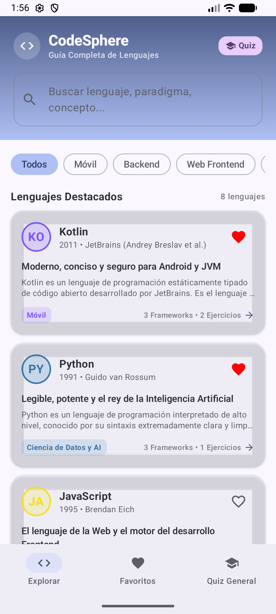
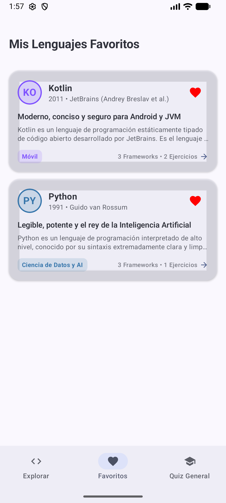
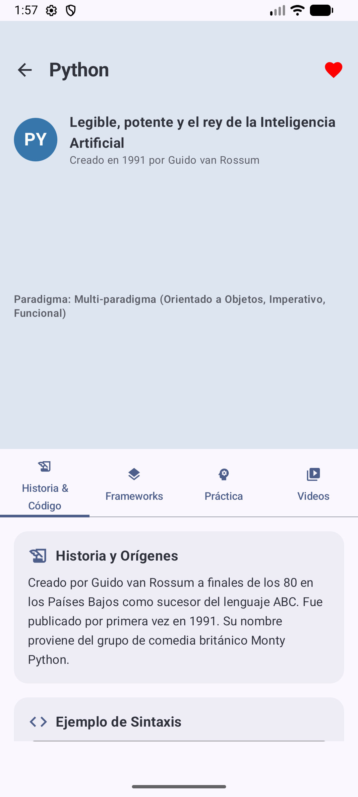
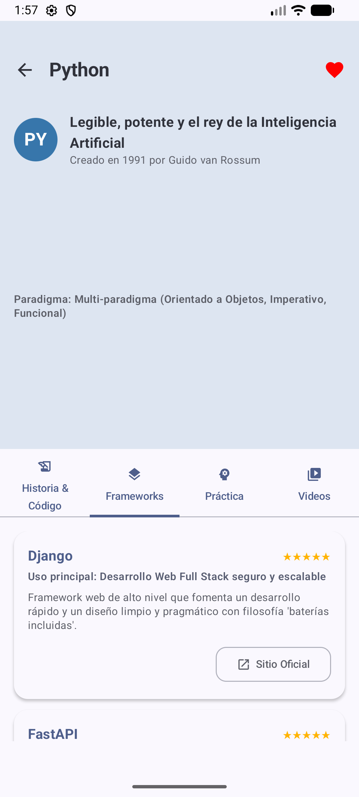
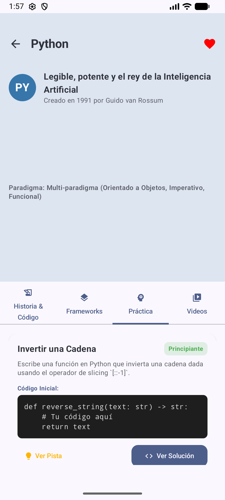
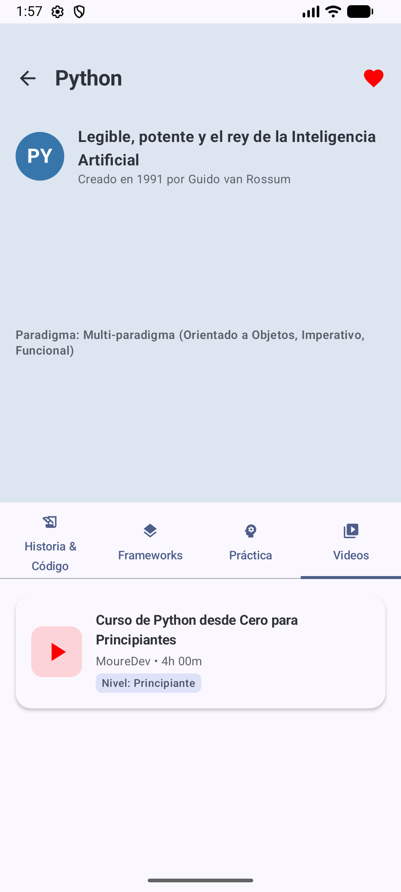
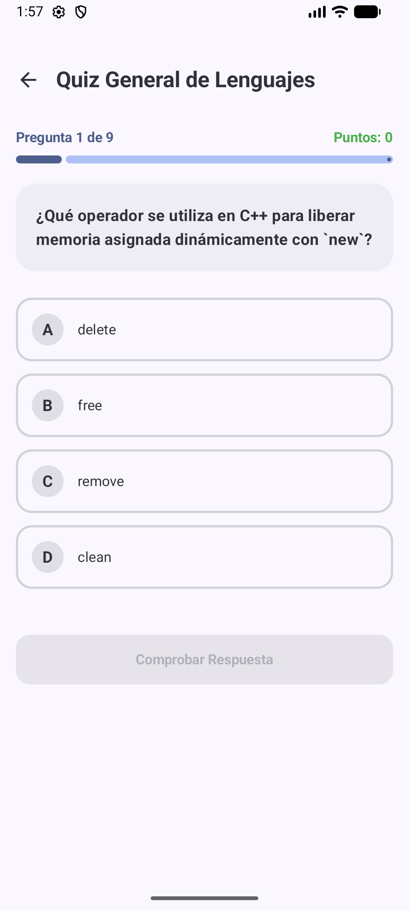

# CodeSphere — Capturas de la aplicación

Capturas reales del APK ejecutado en Android Emulator (1080 × 2400). Pulsa una imagen para verla en tamaño completo.

| Inicio | Favoritos |
| --- | --- |
|  |  |

| Historia y código | Frameworks |
| --- | --- |
|  |  |

| Práctica | Videos |
| --- | --- |
|  |  |

## Quiz General

